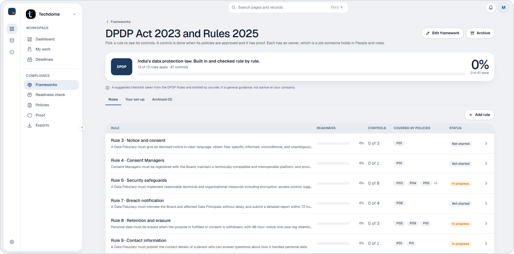

<div align="center">

# Neeti Bharat

**Open-source, self-hosted compliance for India's Digital Personal Data Protection Act.**

Turn the DPDP Act and Rules into a checklist your team can finish: who owns each duty, which policy covers it, and the proof that it is done.

[](https://github.com/neetibharat/neeti-bharat/actions/workflows/ci.yml)
[](LICENSE)

<br />



</div>

<br />

## What it does

- **The Act, rule by rule.** 13 rules, 47 controls and 19 ready-made policies are built in. A control is done when its policies are approved and it has proof. Each control has an owner, which is a job someone holds.
- **Proof, not promises.** 68 pieces of proof an auditor would ask for, with 67 Word templates to fill in. Upload files, add links or notes, and see what is missing, due or late.
- **Policies with approval.** Draft in the editor, send for review, approve with a name and a date. Policies follow your company's own answers.
- **Checks that run themselves.** Read-only connections to Azure and GitHub check how your systems are set up against what the Act expects, on a schedule, with the resource behind every finding.
- **The day-to-day duties.** A breach register with the report clock, requests and complaints from people, a vendor list, training, a website check, and one page of everything that is due or late.
- **An audit trail you can trust.** Every change goes into a tamper-evident activity log. Export an audit pack of CSV files for your auditor.
- **Claude can set it up.** An [MCP server](docs/mcp.md) lets Claude draft frameworks, policies and proof through the API. It saves drafts, and a person approves.
- **AI help, only if you want it.** Off until you set an AI service in the install's environment and an admin turns a feature on. Nothing it suggests is saved on its own. See [docs/ai-help.md](docs/ai-help.md).

It is general guidance drafted with counsel, not legal advice.

## Quick start

Needs Node 22.12 or newer, pnpm 10, and Docker.

```sh
pnpm install
cp .env.example .env
pnpm db:up
pnpm dev
```

The web app runs on http://localhost:3200 and the API on http://localhost:3201/v1/health.

To run it for real, with email, sign-in and file storage for proof, follow [docs/self-hosting.md](docs/self-hosting.md).

## How it is built

| Path              | What it is                                                   |
| ----------------- | ------------------------------------------------------------ |
| `apps/api`        | NestJS API with Prisma and Postgres                          |
| `apps/web`        | Next.js app, translated with next-intl                       |
| `apps/mcp`        | MCP server that lets Claude set up a company through the API |
| `packages/shared` | Types, constants and the DPDP catalogue used by both apps    |

How the pieces fit is in [docs/architecture.md](docs/architecture.md).

### Everyday commands

| Command       | Does                                    |
| ------------- | --------------------------------------- |
| `pnpm check`  | Format check, lint, typecheck and tests |
| `pnpm build`  | Builds every package                    |
| `pnpm format` | Formats the whole repo                  |
| `pnpm db:up`  | Starts Postgres and MinIO in Docker     |

## Documentation

| Area                 | Read                                                                                                                                   |
| -------------------- | -------------------------------------------------------------------------------------------------------------------------------------- |
| Setting up           | [Self-hosting](docs/self-hosting.md), [Onboarding and the readiness check](docs/onboarding.md)                                         |
| The Act and the work | [Frameworks, rules, controls and proof](docs/frameworks.md), [Deadlines](docs/deadlines.md)                                            |
| Duties and records   | [Breaches](docs/breaches.md), [Requests](docs/requests.md), [Vendors](docs/vendors.md), [Training](docs/training.md)                   |
| Checks               | [Connections to Azure and GitHub](docs/connections.md), [Website check](docs/website-check.md), [Proof reports](docs/proof-reports.md) |
| Reports and records  | [Exports and the audit pack](docs/exports.md), [Activity log](docs/activity-log.md), [Notifications](docs/notifications.md)            |
| Automation           | [API keys](docs/api-keys.md), [Claude through MCP](docs/mcp.md), [AI help](docs/ai-help.md)                                            |
| Using the app        | [Search and shortcuts](docs/search.md), [Organisations](docs/organizations.md)                                                         |

## Contributing

Read [CONTRIBUTING.md](CONTRIBUTING.md) for the standards. Run `pnpm check` before you open a pull request.

## Licence

Neeti Bharat is open source under the [GNU Affero General Public License v3.0](LICENSE) (`AGPL-3.0-only`). You can self-host, study and modify it for free, including for commercial use. If you offer a modified version as an online service, the AGPL requires you to share your changes with its users.

Copyright (C) 2026 Techdome Solutions Private Limited.
